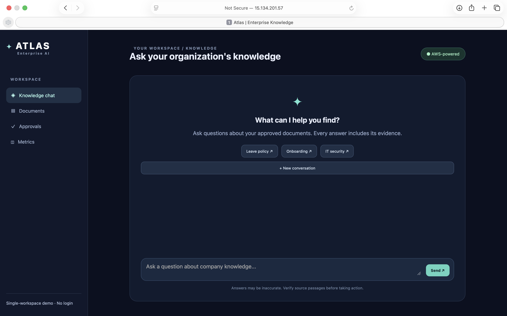
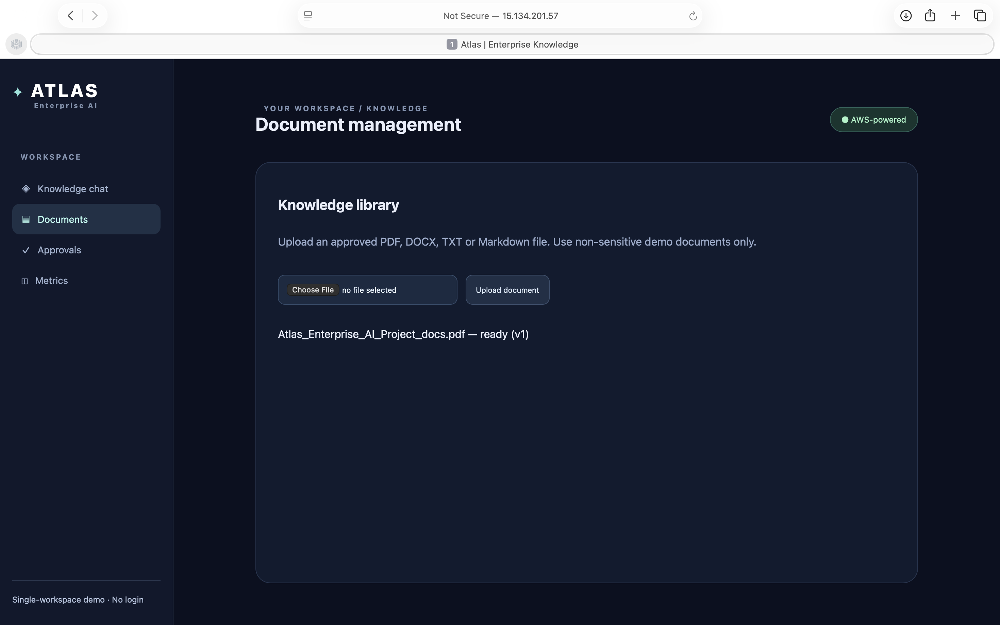
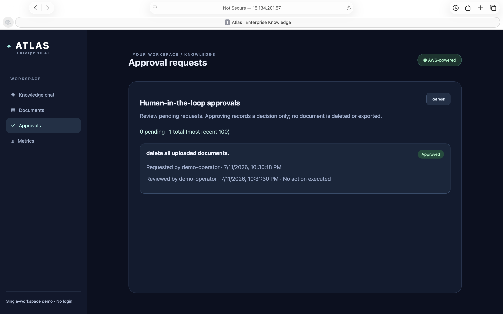
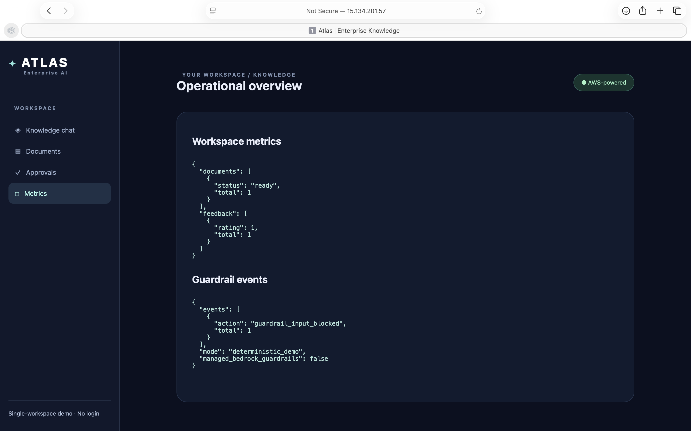

# Atlas Enterprise AI

Atlas is a demo enterprise knowledge assistant built with FastAPI, LangGraph, Amazon Bedrock, Pinecone, and PostgreSQL. It ingests PDF, DOCX, TXT, and Markdown documents, stores conversation and application records, retrieves authorized passages, and generates cited answers.

> Demo context: the current app uses a single demo workspace. It is not a production authentication system.

## Features

- PDF, DOCX, TXT, and Markdown document uploads
- Amazon S3 presigned uploads
- Amazon Bedrock Titan embeddings
- Amazon Bedrock Nova Lite answers
- Pinecone vector search with tenant and document ACL metadata
- PostgreSQL document and conversation storage
- LangGraph retrieval workflow and deterministic guardrails
- Human-in-the-loop approval records
- Source citations with document title and page
- Feedback, metrics, and admin views
- Optional Rius/GlassFlow observability

## Screenshots

### Knowledge Chat



### Documents



### Approvals



### Metrics



## Architecture

```text
Browser
  -> FastAPI
     -> PostgreSQL (documents, conversations, approvals, feedback)
     -> Amazon S3 (uploaded source files)
     -> Amazon Bedrock (embeddings and answers)
     -> Pinecone (vector search)
     -> LangGraph (guard, retrieve, generate, validate)
```

## Project Structure

```text
app/
  main.py          FastAPI routes and application startup
  config.py        Environment configuration
  db.py            PostgreSQL connection helpers
  aws.py           Bedrock and S3 clients
  vector.py        Pinecone indexing and retrieval
  graph.py         LangGraph chat workflow
  rag.py           Graph chat adapter
  memory.py        Conversation history
  guardrails.py    Input/output guardrails
  observability.py Rius tracing setup
  templates/       HTML dashboard
  static/          CSS and JavaScript
worker/
  ingest.py        Document parsing, chunking, embedding, and indexing
infra/
  schema.sql       PostgreSQL database schema
scripts/
  init_db.py       Database initialization utility
docs/
  SETUP.md         Additional setup notes
```

## Requirements

- macOS, Linux, or Windows with WSL
- Python 3.12 recommended
- Amazon AWS account with Bedrock and S3 access
- Pinecone account and API key
- PostgreSQL database, such as Render PostgreSQL
- S3 bucket for document uploads

Bedrock model access must be enabled for both configured models in the AWS region.

## Installation

From a Terminal opened in the project directory:

```bash
cd "/Users/sagarvashnav/Desktop/  ny /ai atlas"
python3.12 -m venv .venv
source .venv/bin/activate
python -m pip install --upgrade pip
python -m pip install -r requirements.txt
```

On Windows PowerShell, activate with:

```powershell
.venv\Scripts\Activate.ps1
```

## Environment Configuration

Create a local environment file:

```bash
cp .env.example .env
```

Then replace the placeholder values in `.env`.

| Variable | Purpose |
|---|---|
| `AWS_ACCESS_KEY_ID` | AWS credential key |
| `AWS_SECRET_ACCESS_KEY` | AWS credential secret |
| `AWS_REGION` | AWS region for Bedrock and S3 |
| `S3_BUCKET` | Upload destination bucket |
| `BEDROCK_EMBED_MODEL` | Bedrock embedding model ID |
| `BEDROCK_CHAT_MODEL` | Bedrock chat model ID |
| `EMBED_DIM` | Embedding vector dimension; must match Pinecone index |
| `PINECONE_API_KEY` | Pinecone API key |
| `PINECONE_INDEX_NAME` | Pinecone index name |
| `PINECONE_CLOUD` | Pinecone cloud provider |
| `PINECONE_REGION` | Pinecone index region |
| `DATABASE_URL` | PostgreSQL connection URL |
| `MIN_RELEVANCE` | Minimum Pinecone similarity score |
| `HITL_ENABLED` | Enable approval prompts for sensitive requests |
| `MEMORY_TURNS` | Number of recent conversation turns retained |
| `RIUS_API_KEY` | Optional Rius API key |
| `RIUS_DISABLED` | Set `true` to disable Rius |

Do not commit `.env`. It is ignored by Git.

## Database Setup

Initialize or update the PostgreSQL schema:

```bash
python scripts/init_db.py
```

The script is safe to rerun and preserves existing rows. It creates:

- `documents`
- `feedback`
- `audit_events`
- `approvals`
- `chat_messages`

Alternatively, apply the schema directly:

```bash
psql "$DATABASE_URL" -f infra/schema.sql
```

## AWS and S3 Setup

1. Create an S3 bucket.
2. Add the bucket name to `S3_BUCKET`.
3. Configure AWS credentials through `.env` or the local AWS credential chain.
4. Enable access to the configured Titan embedding and Nova Lite Bedrock models.
5. Ensure the application identity can use `PutObject`, `GetObject`, and presigned upload operations on the bucket.

## Pinecone Setup

The application creates the configured index automatically if it receives a 404 response. The index uses:

- Dimension: `EMBED_DIM`
- Metric: `cosine`
- Cloud: `PINECONE_CLOUD`
- Region: `PINECONE_REGION`

If the index already exists with a different dimension or metric, change its name or recreate it with matching settings.

## Run the Application

Activate the virtual environment and start Uvicorn:

```bash
source .venv/bin/activate
python -m uvicorn app.main:app --reload --host 127.0.0.1 --port 8000
```

Open:

- Dashboard: http://127.0.0.1:8000
- API docs: http://127.0.0.1:8000/api/docs
- Live health check: http://127.0.0.1:8000/health/live
- Database readiness: http://127.0.0.1:8000/health/ready

Stop the server with `Ctrl+C`.

## Upload and Chat Workflow

1. Open the dashboard.
2. Upload a PDF, DOCX, TXT, or Markdown file.
3. Wait until the document status becomes `ready`.
4. Ask a question supported by that document.
5. Review answer source excerpts and document page citations.

The initial demo PDF is only a project overview and may not answer organization-specific HR questions such as leave policy.

## Important API Endpoints

| Method | Endpoint | Purpose |
|---|---|---|
| `GET` | `/health/live` | Liveness check |
| `GET` | `/health/ready` | PostgreSQL readiness check |
| `GET` | `/api/documents` | List authorized documents |
| `POST` | `/api/documents/uploads` | Create upload metadata and presigned URL |
| `POST` | `/api/documents/complete` | Complete ingestion |
| `POST` | `/api/chat` | Ask a grounded question |
| `GET` | `/api/conversations/{id}/messages` | List conversation history |
| `POST` | `/api/feedback` | Record feedback |
| `GET` | `/api/approvals` | List approval requests |
| `POST` | `/api/approvals/{id}/decision` | Approve or reject a request |
| `GET` | `/api/admin/metrics` | View document and feedback metrics |
| `GET` | `/api/admin/guardrails` | View guardrail metrics |

## Development

Compile Python modules:

```bash
python -m compileall app worker scripts
```

Run tests if available:

```bash
python -m pytest
```

The VS Code interpreter can be selected with:

1. Open the Command Palette.
2. Run `Python: Select Interpreter`.
3. Choose `.venv/bin/python`.

## Troubleshooting

### No evidence found

- Confirm the document status is `ready`.
- Confirm the question is covered by the uploaded document.
- Check `MIN_RELEVANCE`; it defaults to `0.12`.
- Verify the Pinecone namespace contains `tenant-demo-workspace`.

### Database connection fails

- Confirm `DATABASE_URL` is a valid external PostgreSQL URL.
- Run `python scripts/init_db.py`.
- Confirm the database host and credentials allow access from your machine.

### AWS errors

- Check both AWS credential variables.
- Check the AWS region and Bedrock model IDs.
- Confirm S3 bucket permissions and Bedrock model access.

### Pinecone dimension errors

`EMBED_DIM` defaults to `1024`. The Pinecone index must use the same dimension. Change or recreate the index if its configuration does not match.

### Dependency warnings

Python 3.12 is recommended. Python 3.14 was not compatible with pinned dependency versions used by the project.

## Security Notes

- Never commit `.env`, AWS keys, Pinecone keys, database URLs, or Rius keys.
- The demo principal has fixed tenant, subject, and workspace values.
- Replace the demo context with authenticated identity and authorization before production use.
- The approval workflow records decisions but does not execute destructive actions.
- Input and output guardrails are demonstration logic, not a production security boundary.